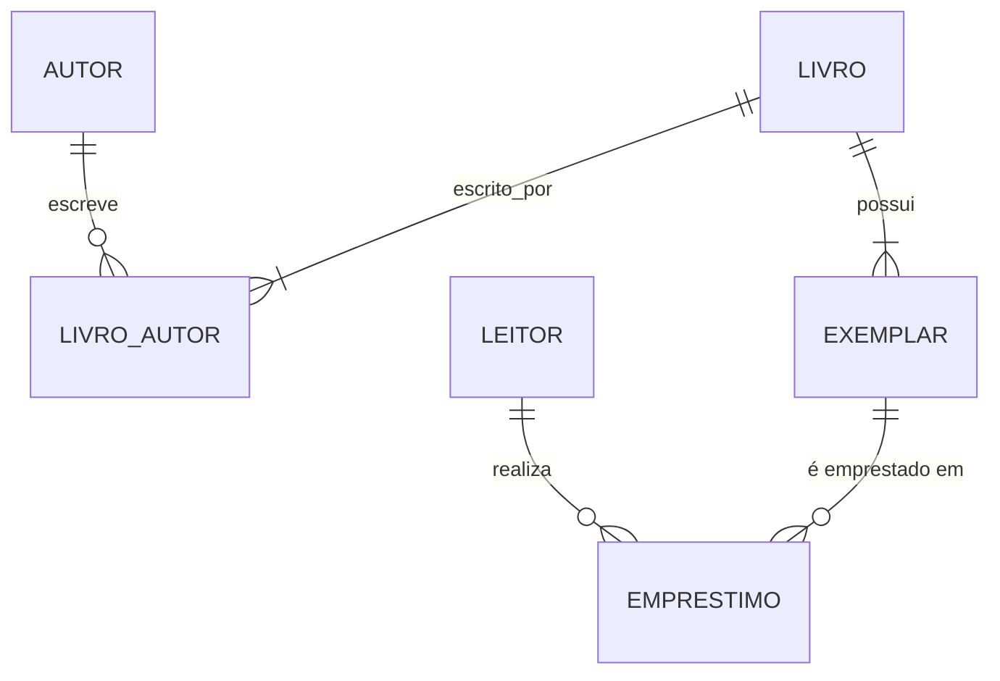

# Banco de Dados com SQLite — Biblioteca

Sistema de **controle de biblioteca** no **SQLite**, o banco de dados embarcado mais usado do mundo (presente em todo celular Android e iOS, navegadores e aplicativos desktop). O repositório traz o modelo em SQL e uma **aplicação Python** que acessa o banco de forma segura.

> Material das disciplinas de Banco de Dados e Desenvolvimento Mobile — Prof. Eduardo Furlanetti.

## Por que SQLite?

- **Sem servidor**: o banco inteiro é um único arquivo (`biblioteca.db`).
- **Zero configuração**: já vem instalado com o Python (`import sqlite3`).
- **SQL completo**: chaves estrangeiras, *triggers*, *views*, CTE, funções de janela, `UPSERT` e busca textual (FTS5).

## Estudo de caso



*Triggers* mantêm a situação de cada exemplar (`DISPONIVEL`/`EMPRESTADO`) e impedem emprestar um exemplar que não está disponível.

## Como executar

Requisito: Python 3.9 ou superior (nada mais).

```bash
python app/biblioteca.py criar            # cria biblioteca.db com dados de exemplo
python app/biblioteca.py buscar banco     # busca textual
python app/biblioteca.py emprestar 3 1 7  # exemplar 3 para o leitor 1, por 7 dias
python app/biblioteca.py devolver 3
python app/biblioteca.py atrasos
```

Para explorar o SQL diretamente:

```bash
sqlite3 biblioteca.db
sqlite> .headers on
sqlite> .mode column
sqlite> .read scripts/03_consultas.sql
```

Também é possível abrir o arquivo no [DB Browser for SQLite](https://sqlitebrowser.org/) ou no DBeaver.

## Conceitos praticados

| Tema | Onde |
|---|---|
| `PRAGMA foreign_keys`, `CHECK`, índice parcial, *triggers* com `RAISE` | `scripts/01_schema.sql` |
| Datas com `date()` e `julianday()`, `GROUP_CONCAT`, `printf` | `scripts/03_consultas.sql` |
| Funções de janela, `UPSERT` (`ON CONFLICT`), busca **FTS5** | `scripts/03_consultas.sql` |
| Consultas parametrizadas, transações e tratamento de erros em Python | `app/biblioteca.py` |

## Estrutura

```
app/biblioteca.py          # aplicação de linha de comando
scripts/
├── 01_schema.sql          # tabelas, triggers e índice FTS5
├── 02_dados.sql           # dados de exemplo
└── 03_consultas.sql       # consultas comentadas
exercicios/
├── lista.md
└── solucoes.sql
```

## Licença

[MIT](LICENSE)
